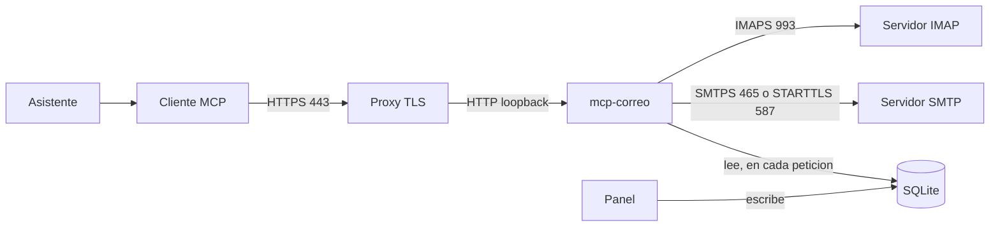

# mcp-correo

**Un servidor [MCP](https://modelcontextprotocol.io) que da a un asistente de IA acceso a buzones IMAP/SMTP de terceros, sin que el asistente pueda escribir sin que una persona lo autorice.**

El asistente habla MCP sobre HTTP. El buzón sigue siendo un servidor IMAP/SMTP
normal: este proyecto no lo administra, no guarda el correo y no decide quién
tiene permiso para leerlo.

## Por qué existe

Muchos agentes solo pueden salir a Internet por HTTPS, el puerto 443. No abren
IMAP (993) ni SMTP (465 o 587), así que no llegan al buzón por sí solos.

mcp-correo corre en un servidor propio. El cliente del asistente se conecta a
ese proceso por HTTPS. El proceso, en la red donde sí hay correo, habla IMAP y
SMTP. El asistente no guarda la contraseña del buzón: la guarda este servidor,
y el cliente solo presenta un Bearer.

## Qué hace y qué no hace

**Hace:**

- Lee el buzón: listar, buscar, ver mensajes y adjuntos, agrupar hilos, buscar
  lo que quedó sin responder.
- Escribe, pero solo tras una confirmación explícita de quien opera el
  asistente: enviar, marcar leído o no leído, borrar, dejar borradores.
- Aísla buzones entre sí: `/mcp/<cuenta>` expone uno solo, con su propia
  credencial, y `/mcp/<dominio>` expone las cuentas de un dominio.
- Gestiona las cuentas desde un panel web, en su propio puerto, y las deja
  disponibles sin reiniciar.

**No hace:**

- No administra el buzón. No crea carpetas, no filtra, no reenvía, no programa
  envíos.
- **No guarda el estado del buzón.** No hay caché de mensajes ni réplica local:
  cada operación abre una conexión IMAP, hace su cosa y la cierra. Lo único
  que **persiste** es el log de auditoría y la configuración de las cuentas.
- No es un servidor de correo. No envía ni recibe por su cuenta.
- No tiene OAuth. La credencial es un Bearer estático.
- No escala en horizontal. Los tokens de confirmación y el cupo diario de
  envíos viven en memoria, así que corre **un solo worker**.

## Características

- Lectura IMAP con `EXAMINE` y `BODY.PEEK`: listar, buscar y leer no marca los
  mensajes como leídos.
- Envío SMTP (`ssl` en el 465 o `starttls` en el 587), con respuesta
  (`In-Reply-To` / `References`), adjuntos limitados y copia en Enviados. Los
  destinarios ocultos no se guardan en la copia.
- Marcar leído o no leído, borrar a la Papelera (o de forma definitiva solo si
  se pidió al preparar) y guardar borradores.
- Cada capacidad de escritura tiene un interruptor global y un permiso
  opcional por dominio y por cuenta, que se gestionan en el panel. El global
  es el maestro: apagado, nada funciona. Encendido, los dominios lo heredan y
  las cuentas heredan del dominio, salvo que digan lo contrario. Apagado, la
  tool no se registra.
- Enviar y borrar piden confirmación en dos pasos. El token dura 10 minutos,
  es de un solo uso y queda ligado a la cuenta y a la operación.
- Varias cuentas, en una base de datos, organizadas por dominios. La
  contraseña va cifrada, y la clave no está en la base de datos.
- Una credencial por cuenta y otra por dominio: cada una abre solo su
  ámbito, y la general abre todo.
- Panel de control en un segundo puerto: dar de alta cuentas, dominios y
  tokens, probar una conexión antes de guardar, y verlas en `/mcp` al
  instante.
- Auditoría JSONL de cada llamada, sin cuerpos ni credenciales.
- Transporte Streamable HTTP, un solo worker de uvicorn.
- Despliegue previsto para Portainer: todo se configura con un `.env`, sin
  tocar ficheros en el servidor.

## Tools

La lectura está siempre disponible. La escritura solo aparece si su
interruptor global está en `true` y alguna cuenta lo permite.

| Tool | Modo | Interruptor |
| --- | --- | --- |
| `list_accounts` | lectura | siempre |
| `list_folders` | lectura | siempre |
| `list_messages` | lectura | siempre |
| `search_messages` | lectura | siempre |
| `get_message` | lectura | siempre |
| `get_attachment` | lectura | siempre |
| `find_unanswered` | lectura | siempre |
| `list_threads` | lectura | siempre |
| `prepare_send` | preparación, no envía | `enable_send` y `allow_send` |
| `send_message` | escritura | los mismos, más `confirm_token` |
| `mark_read` | escritura | `enable_mark` y `allow_mark` |
| `mark_unread` | escritura | `enable_mark` y `allow_mark` |
| `prepare_delete` | preparación, no borra | `enable_delete` y `allow_delete` |
| `delete_message` | escritura | los mismos, más `confirm_token` |
| `create_draft` | escritura | `enable_drafts` y `allow_drafts` |

`list_accounts` es la **guía**: devuelve el ámbito de la ruta y el catálogo
de rutas, con la ruta de cada cuenta y de cada dominio. Es lo primero que
debe llamar el asistente.

`prepare_send` devuelve la vista previa y un `confirm_token`. `send_message`
solo acepta la cuenta y ese token: no se pueden cambiar destinatarios ni asunto
en el segundo paso. Con el borrado pasa lo mismo: `permanent` se fija en
`prepare_delete` y viaja dentro del token. Marcar es directo y queda auditado.
`create_draft` guarda en Borradores y no envía.

## Rutas

| Ruta | Ámbito | Qué ve |
| --- | --- | --- |
| `/mcp` | El dominio por defecto, si hay uno | La guía: el catálogo de rutas. Y las cuentas del dominio por defecto. |
| `/mcp/<dominio>` | Las cuentas de ese dominio | Varias cuentas a la vez. |
| `/mcp/<cuenta>` | Esa cuenta | Una cuenta. La unidad real de seguridad. |

`/mcp` **no** expone todos los buzones: es la puerta de entrada, y dice qué
hay y por dónde se entra. `list_accounts` devuelve el catálogo de rutas, con
la ruta de cada cuenta y de cada dominio. Para abrir un buzón hay que
nombrarlo.

`<cuenta>` puede ser el correo, el nombre de la cuenta o su número.

Hay tres credenciales, y la más específica manda cuando se presenta:

| Credencial | Abre | En qué rutas vale |
| --- | --- | --- |
| `MCP_BEARER_TOKEN` (la general) | Todas las cuentas | Todas |
| La del dominio | Las cuentas de ese dominio | `/mcp/<dominio>` y las cuentas suyas |
| La de la cuenta | Esa cuenta | `/mcp/<cuenta>` |

La regla: **la credencial tiene que abrir la ruta**. La de una cuenta no
abre la ruta de un dominio, y la de un dominio no abre la de otro.

El aislamiento no es cosmético. La ruta acota el conjunto de cuentas que una
tool puede tocar, y la comprobación está en un único punto del código. Un
cliente que solo tiene el bearer de una cuenta **no puede** llegar a las demás
ni aunque se lo filtren.

En una ruta de una sola cuenta, el argumento `account` de las tools es
opcional: la cuenta ya la fija la ruta y no hace falta que el modelo la sepa.

## El panel de control

Un panel web, en **otro puerto**, para dar de alta las cuentas sin tocar el
despliegue. Las cuentas salen de una base de datos SQLite, se organizan por
dominios, y **en cuanto existen ya están en `/mcp`**: no hay que reiniciar.

El panel tiene su propia credencial, su propia sesión y su propia capa
anti-CSRF. Y no puede leer ni escribir un buzón: solo gestiona la
configuración y prueba conexiones.

Ver [docs/dashboard.md](docs/dashboard.md).

## Seguridad

- **Bearer.** `MCP_BEARER_TOKEN` es obligatorio (mínimo 16 caracteres). Se
  compara el SHA-256 con `hmac.compare_digest`. Sin token, `/mcp` responde
  401. `GET /health` responde `{"status":"ok"}` y no devuelve correo: es la
  sonda del contenedor.
- **Credenciales por cuenta y por dominio.** La de una cuenta da acceso a
  una sola cuenta y solo por su ruta; la de un dominio, a las de ese
  dominio. No puede ser igual al bearer global ni repetirse.
- **Contraseñas cifradas en la base.** Las contraseñas de las cuentas se
  cifran con AES-GCM y una clave que **no** está en la base de datos
  (`MCP_DASHBOARD_KEY`). Si se pierde la clave, no se pueden descifrar.
- **El panel no lee buzones.** Ni una tool. El panel gestiona la
  configuración; los buzones son del MCP.
- **Solo lectura por defecto.** `MCP_ENABLE_SEND`, `MCP_ENABLE_MARK`,
  `MCP_ENABLE_DELETE` y `MCP_ENABLE_DRAFTS` salen en `false`. Los permisos de
  dominio y de cuenta se gestionan en el panel. Un interruptor solo admite
  `true`, `false`, `1` y `0`: cualquier otro texto aborta el arranque. Un texto
  `"false"` no enciende un interruptor, y un `"yes"` tampoco lo apaga en
  silencio.
- **Confirmación en dos pasos.** Enviar y borrar no se ejecutan con la primera
  llamada. El token caduca, no se reutiliza y no sirve para otra cuenta ni para
  otra operación. El cupo diario solo cuenta un envío que el SMTP aceptó.
- **Auditoría sin cuerpos.** Cada línea anota fecha, tool, cuenta y argumentos
  reducidos (destinatarios o UID, asunto, nombres de fichero). No anota
  cuerpos, adjuntos, el `confirm_token` ni contraseñas. Si no puede escribir la
  línea, la tool no muta el buzón ni emite un token.
- **Inyección de instrucciones.** Asuntos, cuerpos y nombres de adjunto son
  datos no confiables. Las instrucciones del servidor dicen que un correo no es
  una orden: `send_message` y `delete_message` solo tras una orden explícita
  de quien opera el asistente, en esa conversación, después de ver la vista
  previa.
- **Red.** Por defecto el proceso escucha en `127.0.0.1`. Otro host exige
  `MCP_ALLOW_NONLOCAL_BIND=1`. `allowed_hosts` y `allowed_origins` cortan el
  DNS rebinding. Hacia Internet hace falta TLS en un proxy. Un solo worker: los
  tokens y el cupo viven en memoria, así que un reinicio los pierde.

La checklist de quien despliega está en [docs/seguridad.md](docs/seguridad.md).

## Arquitectura



El asistente solo necesita el puerto 443 hacia el proxy. IMAP y SMTP salen de
mcp-correo, en la máquina donde el buzón es alcanzable. La lectura usa
`EXAMINE`. La escritura abre la carpeta en lectura-escritura solo dentro de la
operación que lo necesita. El `From` de un envío es el usuario de la cuenta.

Con Cloudflare Tunnel, el proxy TLS es el edge de Cloudflare y `cloudflared`
habla HTTP plano con el contenedor por la red de Docker. No hace falta Caddy.

El panel es un segundo servidor HTTP **en el mismo proceso**, en otro
puerto. Comparte la base de datos y la auditoría, y no comparte nada más:
no registra tools ni puede tocar un buzón.

## Cómo se usa

El servidor se configura por entorno; los dominios y las cuentas se gestionan
desde el panel.

### El arranque

Las cuentas se gestionan desde el panel, y el panel necesita dos secretos.
No hay más que definir:

```bash
python3 -m venv .venv
.venv/bin/pip install -r requirements.txt
export MCP_BEARER_TOKEN="$(openssl rand -base64 48)"   # el asistente
export MCP_DASHBOARD_KEY="$(openssl rand -base64 48)"   # cifra las contraseñas
export MCP_DASHBOARD_TOKEN="$(openssl rand -base64 48)" # abre el panel
export MCP_AUDIT_LOG=./audit.jsonl
.venv/bin/python server.py
```

La base de datos va a `./cuentas.db` si no dices otra cosa
(`MCP_DASHBOARD_DB`). **Ponla donde persista**: en el contenedor, sobre el
volumen de datos.

Levantan dos superficies:

| | Puerto | Credencial | Para qué |
| --- | --- | --- | --- |
| MCP | 8765 | `MCP_BEARER_TOKEN` | Lo que consume el asistente |
| Panel | 8766 | `MCP_DASHBOARD_TOKEN` | Dar de alta cuentas y dominios |

El MCP queda en `http://127.0.0.1:8765/mcp` y el panel en
`http://127.0.0.1:8766`. El contrato completo de variables está en
[docs/configuracion.md](docs/configuracion.md).

### El flujo de uso

1. **Entra al panel** en `http://127.0.0.1:8766` con `MCP_DASHBOARD_TOKEN`.
2. **Crea un dominio** (por ejemplo `corp.example.com`). Es el grupo de
   cuentas, y le puedes poner el servidor IMAP y SMTP por defecto.
3. **Introduce los datos de una cuenta** dentro del dominio y prueba la
   conexión antes de guardar. Si el host, el puerto o la contraseña están
   mal, lo ves ahí.
4. **Guarda la cuenta.** La contraseña se cifra y se guarda. Se genera su
   token, que se muestra **una sola vez**: cópialo.
5. **Ya está.** La cuenta está en `/mcp/<cuenta>` en la siguiente
   petición, sin reiniciar nada. Y `list_accounts` la enseña en el
   catálogo.
6. **Apunta el cliente** a la ruta que quieras y dale su credencial:

   ```bash
   https://mcp.example.com/mcp/ada@corp.example.com
   Authorization: Bearer <el token de la cuenta>
   ```

7. **Marca un dominio como por defecto** si quieres que `/mcp` abra sus
   cuentas. Si no hay ninguno, `/mcp` es solo la guía.

Las cuentas se crean y modifican desde el panel; el servidor las lee de la
base de datos.

El panel **no puede leer ni escribir un buzón**. Solo gestiona la
configuración y prueba conexiones. Ver
[docs/dashboard.md](docs/dashboard.md).

### Docker

```bash
export MCP_BEARER_TOKEN="$(openssl rand -base64 48)"
export MCP_DASHBOARD_KEY="$(openssl rand -base64 48)"
export MCP_DASHBOARD_TOKEN="$(openssl rand -base64 48)"
docker compose -f docker-compose.yml -f docker-compose.local.yml up --build
```

Las cuentas se dan de alta después, desde el panel: el compose no declara
ninguna. Sin `MCP_IMAGE`, la imagen construida se llama `mcp-correo:local` y
no está en ningún registro.

La base de datos va en el volumen `data`, que el compose base declara y
monta en `/var/lib/mcp-correo`. Sin ese volumen el contenedor es de solo
lectura y las cuentas se perderían en cada reinicio.

## Configuración

Todo se define con variables de entorno. La lista completa, con tipos, valores
por defecto y los errores que puede dar cada una, está en
[docs/configuracion.md](docs/configuracion.md).

```bash
# El secreto que presenta el cliente MCP. Obligatorio, mínimo 16 caracteres.
export MCP_BEARER_TOKEN="$(openssl rand -base64 48)"

# Credenciales del panel: guárdalas, especialmente la clave de cifrado.
export MCP_DASHBOARD_KEY="$(openssl rand -base64 48)"
export MCP_DASHBOARD_TOKEN="$(openssl rand -base64 48)"
```

| Variable | Uso |
| --- | --- |
| `MCP_BEARER_TOKEN` | Obligatoria. El bearer general: abre todas las rutas. En producción, `openssl rand -base64 48`. |
| `MCP_PUBLIC_HOST` | El nombre público del servidor. Arma `allowed_hosts` y `allowed_origins`. Con túnel, es el hostname del túnel. |
| `MCP_ALLOWED_HOSTS`, `MCP_ALLOWED_ORIGINS` | Listas separadas por comas. Sustituyen a las derivadas de `MCP_PUBLIC_HOST`. |
| `MCP_ENABLE_SEND`, `MCP_ENABLE_MARK`, `MCP_ENABLE_DELETE`, `MCP_ENABLE_DRAFTS` | Interruptores **globales** de escritura. Son el maestro: apagados, la capacidad está apagada para todas las cuentas. Encendidos, los dominios los heredan, y las cuentas heredan del dominio. |
| `MCP_BIND_HOST`, `MCP_BIND_PORT` | Por defecto `127.0.0.1` y `8765`. |
| `MCP_AUDIT_LOG` | JSONL. Por defecto `./audit.jsonl`. |
| `MCP_DASHBOARD_DB` | Ruta del fichero SQLite. Por defecto `cuentas.db`; en el contenedor, `/var/lib/mcp-correo/cuentas.db`, sobre el volumen de datos. |
| `MCP_DASHBOARD_KEY` | Clave con la que se cifran las contraseñas. **Obligatoria.** No está en la base de datos: si se pierde, no se descifran. |
| `MCP_DASHBOARD_TOKEN` | Credencial de acceso al panel. **Obligatoria**, y distinta de `MCP_BEARER_TOKEN`. |
| `MCP_DASHBOARD_BIND_HOST`, `MCP_DASHBOARD_BIND_PORT` | Por defecto `127.0.0.1` y `8766`. |

Los permisos específicos de cada dominio y cuenta se configuran en el panel.

Los topes (`max_results`, `max_chars`, `max_attachment_bytes`, destinatarios,
cupo diario, UID por llamada) tienen su variable `MCP_MAX_*`,
`MCP_*_TIMEOUT`, `MCP_*_SECONDS` o `MCP_SENT_SCAN_LIMIT`, y el cliente no
puede subirlos.

Un interruptor solo admite `true`, `false`, `1` y `0`. Cualquier otro texto
aborta el arranque: un interruptor mal escrito no puede quedarse en apagado
sin que nadie se entere. La tabla de errores está en
[docs/configuracion.md](docs/configuracion.md).

## Despliegue

| Fichero | Para qué |
| --- | --- |
| `docker-compose.yml` | **Base.** El MCP, el panel y la rotación de la auditoría. No publica nada fuera de loopback: los puertos quedan en `127.0.0.1:8765` y `127.0.0.1:8766`. |
| `docker-compose.tunnel.yml` | Exposición por Cloudflare Tunnel. Añade `cloudflared`. No hace falta abrir puertos ni Caddy. Solo lleva el MCP, no el panel. |
| `docker-compose.proxy.yml` | TLS propio con Caddy y Let's Encrypt. Solo si no usas túnel. |
| `docker-compose.local.yml` | Desarrollo local. No declara cuentas: se dan de alta en el panel. |

Un overlay se añade con `-f`, y en Portainer con **Additional paths**:

```bash
docker compose -f docker-compose.yml -f docker-compose.tunnel.yml up -d --build
```

En Portainer, el stack se crea desde Git con el compose base, se sube el `.env`
con *Environment variables → Load variables from .env file*, y se añade el
overlay del túnel en *Additional paths*.

La imagen publicada se usa sin reconstruir:

```
MCP_IMAGE=ghcr.io/davidneyra2804/mcp-correo:2.0.0
MCP_PULL_POLICY=always
```

Con `MCP_PULL_POLICY` vacío, el compose construye la imagen localmente y
`audit-rotate` usa esa misma imagen sin volver a construirla.

Las guías completas:

- [Configuración](docs/configuracion.md)
- [El panel de control](docs/dashboard.md)
- [Portainer y Docker](docs/despliegue-portainer.md)
- [Cloudflare Tunnel](docs/despliegue-tunel-cloudflare.md)
- [systemd y nginx](docs/despliegue-systemd.md)
- [Checklist de seguridad](docs/seguridad.md)

## Conectar un cliente y probarlo

URL local: `http://127.0.0.1:8765/mcp`. Detrás de un proxy:
`https://mcp.example.com/mcp`. Cabecera `Authorization: Bearer <token>`.
Transporte Streamable HTTP.

La URL decide qué buzones ve el cliente:

| URL | Qué ve |
| --- | --- |
| `.../mcp` | La guía: el catálogo de rutas. Y las cuentas del dominio por defecto, si hay uno. |
| `.../mcp/corp.example.com` | Las cuentas de ese dominio. |
| `.../mcp/ada@corp.example.com` | Esa cuenta. |

Sin token la respuesta es 401 y el cuerpo no repite lo que se envió:

```bash
curl -i http://127.0.0.1:8765/mcp \
  -H 'Content-Type: application/json' \
  -H 'Accept: application/json, text/event-stream' \
  -d '{}'
```

Con token, `tools/list` (modo sin estado). Sin cuentas dadas de alta, son las
ocho tools de lectura:

```bash
curl -sS http://127.0.0.1:8765/mcp \
  -H "Authorization: Bearer $MCP_BEARER_TOKEN" \
  -H 'Content-Type: application/json' \
  -H 'Accept: application/json, text/event-stream' \
  -d '{"jsonrpc":"2.0","id":1,"method":"tools/list","params":{}}'
```

Y `list_accounts`, que es la guía: dice qué cuentas hay y con qué ruta se
entra a cada una.

```bash
curl -sS http://127.0.0.1:8765/mcp \
  -H "Authorization: Bearer $MCP_BEARER_TOKEN" \
  -H 'Content-Type: application/json' \
  -H 'Accept: application/json, text/event-stream' \
  -d '{"jsonrpc":"2.0","id":1,"method":"tools/call","params":{"name":"list_accounts","arguments":{}}}'
```

MCP Inspector:

```bash
npx @modelcontextprotocol/inspector --cli http://127.0.0.1:8765/mcp \
  --transport http \
  --header "Authorization: Bearer $MCP_BEARER_TOKEN" \
  --method tools/list
```

En la UI, el mismo transporte, la misma URL y la cabecera `Authorization`. Para
el Inspector abierto en el navegador, deja `http://127.0.0.1:*` y
`http://localhost:*` en `allowed_origins`.

Un `Host` que no esté permitido responde 421. Un `Origin` que no esté permitido
responde 403.

## Qué se guarda

Dos cosas, y solo dos:

- Un **JSONL** con una línea por llamada a una tool, con fecha, tool, cuenta
  y argumentos reducidos. Está en el volumen `audit` del stack. También se
  anotan los cambios del panel.
- Una **base SQLite** con los dominios y las cuentas, en el volumen `data`.
  Las contraseñas van cifradas.

```bash
docker compose exec mcp cat /var/log/mcp-correo/audit.jsonl
```

El log rota cuando pasa de 10 MiB (lo comprueba cada hora) y conserva 12
copias. No sale del host: si quieres verlo fuera, sácalo con `docker cp`.

La base de datos del panel se copia del volumen `data`. **Sin
`MCP_DASHBOARD_KEY` la copia no sirve de nada**: las contraseñas van
cifradas con esa clave, y la clave no está en la base de datos. Copia las
dos cosas, y la clave aparte.

## Estructura

```
server.py                 # MCPServer, Bearer, enrutado por cuenta
config.py                 # variables de entorno, interruptores y límites
scope.py                  # el ámbito de la petición: qué cuentas puede tocar
audit.py                  # JSONL de cada llamada
version.py                # la versión, fuente de verdad
mail/                     # IMAP, SMTP, MIME, confirmación y escritura
store/                    # la base de datos: esquema, cifrado y cuentas
dashboard/                # el panel: su API, su sesión y su interfaz
.env.example              # todas las variables, con valores ficticios
Dockerfile                # imagen slim, usuario mcp, sin secretos
docker-compose.yml        # base: el MCP, el panel y la rotación de la auditoría
docker-compose.tunnel.yml # overlay de Cloudflare Tunnel
docker-compose.proxy.yml  # overlay de Caddy con TLS propio
docker-compose.local.yml  # overlay de desarrollo local
docker/                   # rotación del JSONL y sonda de salud
herramientas/             # scripts de apoyo, como la prueba de humo
deploy/                   # systemd, nginx, Caddy opcional y logrotate
docs/                     # configuración, despliegue, panel y checklist
tests/                    # pytest con IMAP y SMTP simulados, sin red
AGENTS.md                 # directrices para quien trabaje en el proyecto
```

## Desarrollo y tests

No hace falta red ni un buzón real. El doble de IMAP marca `\Seen` si alguien
pide el cuerpo sin `PEEK`. El doble de SMTP no abre un socket.

```bash
python3 -m venv .venv
.venv/bin/pip install -r requirements.txt -r requirements-dev.txt
.venv/bin/ruff check .
.venv/bin/ruff format --check .
.venv/bin/pytest
```

CI hace lo mismo con Python 3.12.

Si vas a tocar el proyecto, [AGENTS.md](AGENTS.md) tiene las directrices: qué
se considera un fallo, qué trampas ya se han pagado y cómo se publica.

## Versionado

SemVer. `version.py` es la fuente de verdad: un test la sincroniza con
`pyproject.toml` y con la etiqueta de la imagen, así que no se pueden separar.
La versión aparece en el handshake MCP y en el log de arranque.

Las etiquetas `vX.Y.Z` disparan [release.yml](.github/workflows/release.yml),
que hace tres cosas: pasa los tests, publica la imagen en GHCR y crea el
Release con las notas de los commits.

```bash
# Publicar una versión
sed -i 's/__version__ = ".*"/__version__ = "2.0.1"/' version.py
sed -i 's/^version = ".*"/version = "2.0.1"/' pyproject.toml
sed -i 's/ARG MCP_VERSION=.*/ARG MCP_VERSION=2.0.1/' Dockerfile
sed -i 's/mcp-correo 2\.0\.0 |/mcp-correo 2.0.1 |/' docs/configuracion.md README.md
sed -i 's|mcp-correo:2\.0\.0|mcp-correo:2.0.1|' README.md
git commit -am "version 2.0.1"
git tag v2.0.1 && git push origin v2.0.1
```

Los dos últimos `sed` no son opcionales: un test comprueba que la
documentación no habla de una versión vieja.

## Hoja de ruta

- OAuth 2.1, con el SDK como resource server, si un cliente no acepta un
  Bearer estático.
- Pool de conexiones IMAP. IDLE queda fuera de momento.
- Particularidades de buzones Zextras Carbonio (nombres de carpetas y
  convenciones), sobre el mismo IMAP/SMTP.
- Varios usuarios en el panel, con su propia credencial y su propia sesión.
  Ahora hay una sola: `MCP_DASHBOARD_TOKEN`.
- Historial de cambios en el panel. La auditoría dice qué se hizo, no el
  antes y el después.

## Licencia

[MIT](LICENSE). Copyright 2026 David Neyra.
