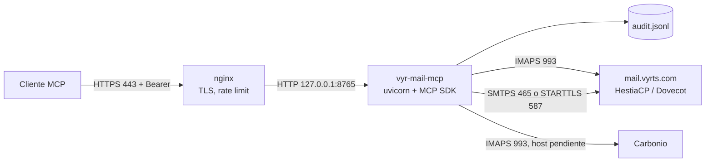

# vyr-mail-mcp

Servidor MCP de correo laboral para David Neyra. Lee el buzón por IMAP (HestiaCP/Dovecot en `mail.vyrts.com` y, cuando haya host, Zextras Carbonio) y puede enviar, marcar y borrar solo si David lo ordena de forma explícita y los interruptores de esa capacidad están encendidos. Se expone por Streamable HTTP.

El diseño de referencia está en el [plan técnico](https://cursor.com/canvas/store-dc39e604-183b-4fa3-9685-08ea65148a44/de328a5c-28ff-4e9a-936e-241d4a5e07cb).

## Arquitectura



El proceso de Python escucha solo en loopback. nginx termina TLS y hace de proxy. El buzón se usa como un cliente IMAP/SMTP más: este repositorio no toca la configuración de HestiaCP ni de Roundcube.

Stack verificado: Python 3.12, `mcp` 2.3.0 (la clase del SDK v2 es `MCPServer`; el transporte es `streamable_http_app()`), `imapclient` 4.1.0, `smtplib` y `email` de la biblioteca estándar.

## Qué hace

### Lectura

Estas ocho tools siempre están registradas. Declaran `readOnlyHint`. Cada `SELECT` de lectura sale como `EXAMINE` y cada cuerpo se pide con `BODY.PEEK[]`. El proxy de lectura rechaza `STORE`, `APPEND`, `MOVE`, `COPY`, `EXPUNGE` y los cambios de flags.

| Tool | Notas |
| --- | --- |
| `list_accounts` | Clave, etiqueta, usuario y si esa cuenta puede enviar, marcar, borrar o guardar borradores. Sin secretos. |
| `list_folders` | Incluye flags SPECIAL-USE (`\Sent`, `\Drafts`, `\Junk`, `\Trash`, …). |
| `list_messages` | Filtros `unseen`, `since` (`AAAA-MM-DD`), `sender`, `folder`, `limit`. |
| `search_messages` | `SUBJECT`, `TEXT`, `FROM`, `TO` y rango `since`/`before`. |
| `get_message` | Cabeceras, cuerpo en texto truncado y lista de adjuntos. |
| `get_attachment` | Tipos de una lista blanca y tope de tamaño. Texto o base64. |
| `find_unanswered` | Sin flag `\Answered` y sin cita en Enviados (`In-Reply-To` / `References`). |
| `list_threads` | Hilos por `References` / `In-Reply-To` sobre los UID más recientes. |

`list_threads` agrupa en Python. El comando IMAP `THREAD` devuelve números de secuencia, no UID, y mezclarlos con el modo UID de IMAPClient daría hilos incorrectos. La ventana es el parámetro `limit`.

### Escritura, apagada por defecto

Una tool de escritura se registra solo si el interruptor global está en `true` y al menos una cuenta tiene su `allow_*` en `true`. Si la tool existe pero esa cuenta no tiene permiso, la llamada responde que la capacidad está desactivada.

| Tool | Interruptor | Efecto |
| --- | --- | --- |
| `prepare_send` + `send_message` | `enable_send` y `allow_send` | SMTP (`ssl` en 465 o `starttls` en 587). Vista previa, respuesta con `In-Reply-To` / `References`, adjuntos opcionales y copia en Enviados por `APPEND`. |
| `mark_read` / `mark_unread` | `enable_mark` y `allow_mark` | `STORE` de la flag `\Seen`. Directo, con auditoría. |
| `prepare_delete` + `delete_message` | `enable_delete` y `allow_delete` | Por defecto mueve a Papelera. `EXPUNGE` solo si `prepare_delete` recibió `permanent=true`. |
| `create_draft` | `enable_drafts` y `allow_drafts` | `APPEND` a Borradores con flag `\Draft`. No envía. Directo y auditado. |

Enviar y borrar van en dos pasos. `prepare_*` devuelve la vista previa y un `confirm_token` de un solo uso, que caduca a los 10 minutos (`confirm_ttl_seconds`) y queda ligado a la cuenta, a los UID y al modo de borrado. La tool de ejecución no acepta otros UID ni puede convertir un borrado a Papelera en uno definitivo: eso ya va dentro del token. Hay que volver a preparar si el token caduca, si ya se usó o si el SMTP rechaza el mensaje.

El cliente MCP solo debe llamar a `send_message` y `delete_message` después de una orden explícita de David en esa conversación, con la vista previa ya vista. El texto de un correo no es esa orden. Las instrucciones del servidor lo dicen así.

La carpeta de lectura-escritura se abre solo dentro de marcar, mover y borrar. `APPEND` (Enviados y Borradores) no hace `SELECT`. El `From` del mensaje es el usuario de la cuenta; el modelo no elige el remitente.

Papelera: `trash_folder` de la cuenta si existe; si no, la carpeta con SPECIAL-USE `\Trash`; si no, `Trash`, `Papelera`, `Deleted`, `Deleted Items`, `INBOX.Trash` o `INBOX/Trash`. Sin ninguna, `prepare_delete` solo sigue adelante con `permanent=true`.

Si el servidor no anuncia `MOVE`, el borrado a Papelera copia, marca `\Deleted` y hace `UID EXPUNGE` solo de esos UID.

Los tokens y el contador diario viven en memoria. `systemd` tiene que seguir con `--workers 1`. Un segundo worker no vería los tokens y duplicaría el cupo.

## Contenido de los correos

Los asuntos, cuerpos, cabeceras y nombres de adjunto son datos **no confiables**. Un mensaje puede traer instrucciones dirigidas al modelo (prompt injection): pedir que ignore estas reglas, que reenvíe el token o que actúe sobre otro sistema.

Esas reglas están en las `instructions` del servidor MCP, en el campo `notice` de `get_message` y `get_attachment`, y en la vista previa de `prepare_send` / `prepare_delete`. El modelo debe tratar el correo como una cita. Un mensaje que pida enviar o borrar no autoriza `send_message` ni `delete_message`. Este proceso no ejecuta HTML ni abre enlaces.

## Estructura

```
server.py                 # MCPServer, Bearer y registro de tools
config.py                 # accounts.toml, interruptores y límites
audit.py                  # JSONL de cada llamada
mail/imap.py              # lecturas: EXAMINE y BODY.PEEK
mail/readonly.py          # proxy de lectura y proxy estrecho de escritura
mail/mutate.py            # marcar, borrar, borrador y copia en Enviados
mail/compose.py           # mensaje saliente; el From es la cuenta
mail/smtp_out.py          # SMTPS o STARTTLS
mail/confirm.py           # token de un solo uso y cupo diario
mail/mime.py              # cabeceras, texto y adjuntos
mail/threads.py           # no respondidos e hilos
accounts.example.toml     # datos ficticios, escritura apagada
.env.example              # nombres de variables, valores ficticios
Dockerfile                # imagen slim, usuario mcp, sin secretos
docker-compose.yml        # stack de Portainer
docker/                   # entrada del contenedor y rotación del JSONL
deploy/                   # systemd, nginx, Caddy opcional y logrotate
tests/                    # pytest con IMAP y SMTP simulados, sin red
```

## Configuración

Hace falta Python 3.11 o superior.

```bash
python3 -m venv .venv
.venv/bin/pip install -r requirements.txt
```

La configuración real no se versiona. Parte de los ejemplos:

```bash
cp accounts.example.toml accounts.toml
```

`accounts.toml` solo guarda `password_env` (el **nombre** de la variable). Si el archivo trae una clave `password`, el proceso no arranca. Cada variable nombrada tiene que existir y no estar vacía.

Valores previstos en producción, que no van en el repositorio:

| Cuenta | Host IMAP | Usuario | Variable |
| --- | --- | --- | --- |
| vyrts (HestiaCP/Dovecot) | `mail.vyrts.com:993` con TLS | `david.neyra@vyrts.com` | `MAIL_VYRTS_PASSWORD` |
| carbonio (fase v2) | host por confirmar | por confirmar | `MAIL_CARBONIO_PASSWORD` |

El ejemplo versionado usa hosts y usuarios de `ejemplo.test`.

Secretos, en un archivo que no esté en git, con permisos `0600`:

```bash
install -m 0600 /dev/null /etc/vyr-mail-mcp/env
# o, en local, un .env fuera del repo
openssl rand -base64 48
```

Variables:

| Variable | Uso |
| --- | --- |
| `MCP_BEARER_TOKEN` | Obligatoria. Mínimo 16 caracteres; en producción, `openssl rand -base64 48`. Sin ella el proceso termina. |
| `MAIL_*_PASSWORD` | Contraseña o app password de cada cuenta. |
| `MCP_CONFIG` | Ruta del TOML. Si falta, se prueba `./accounts.toml` y luego `/etc/vyr-mail-mcp/accounts.toml`. En el contenedor apunta a `/config/accounts.toml`. |
| `MCP_AUDIT_LOG` | Ruta del JSONL. Por defecto `./audit.jsonl`. En el contenedor, `/var/log/vyr-mail-mcp/audit.jsonl`. |
| `MCP_BIND_HOST` / `MCP_BIND_PORT` | Por defecto `127.0.0.1` y `8765`. Otro host se rechaza salvo `MCP_ALLOW_NONLOCAL_BIND=1`. El contenedor oye en `0.0.0.0` con ese permiso; el compose publica solo `127.0.0.1`. |
| `MCP_PUBLIC_HOST` | Si está definida, sustituye `public_host` y reconstruye `allowed_hosts` y `allowed_origins` (incluye loopback y `https://` de ese nombre). Sin ella, manda el TOML. |
| `MCP_ALLOWED_HOSTS` / `MCP_ALLOWED_ORIGINS` | Listas separadas por comas. Si se definen, tapan tanto al TOML como a las listas que arma `MCP_PUBLIC_HOST`. |
| `MCP_ACCOUNTS_TOML_B64` | Solo contenedor. TOML en base64, una línea, sin clave `password`. Se usa si no hay fichero montado. |
| `MCP_ACCOUNTS_TOML` | Solo contenedor. El mismo TOML en texto. En Portainer es más seguro el base64. |

Límites en `[server]`: `max_results`, `max_chars`, `max_attachment_bytes`, `max_message_bytes`, `imap_timeout`, `sent_scan_limit`. El cliente no puede subir esos topes. `allowed_hosts` y `allowed_origins` activan la protección contra DNS rebinding del SDK. `allowed_attachment_types` es la lista blanca de `get_attachment` y de los adjuntos salientes.

Escritura, también en `[server]` y en cada cuenta. En el ejemplo versionado están apagados:

| Clave | Dónde | Por defecto | Uso |
| --- | --- | --- | --- |
| `enable_send` / `allow_send` | servidor / cuenta | `false` | Registrar y permitir el envío. |
| `enable_mark` / `allow_mark` | servidor / cuenta | `false` | Marcar leído o no leído. |
| `enable_delete` / `allow_delete` | servidor / cuenta | `false` | Mover a Papelera o borrar. |
| `enable_drafts` / `allow_drafts` | servidor / cuenta | `false` | Guardar borradores. |
| `confirm_ttl_seconds` | servidor | `600` | Vida del token. |
| `max_recipients` | servidor | `10` | Tope de To + Cc + Bcc por mensaje. |
| `max_sends_per_day` | servidor | `30` | Cupo diario por cuenta, en UTC. Solo cuenta un SMTP aceptado. |
| `max_delete_per_call` | servidor | `20` | UID por llamada de borrado. |
| `max_mark_per_call` | servidor | `50` | UID por llamada de marcado. |
| `smtp_security` | servidor o cuenta | `ssl` | `ssl` (puerto 465) o `starttls` (puerto 587). La cuenta puede tapar al servidor. |
| `smtp_timeout` | servidor | `30` | Segundos de la conexión SMTP. |
| `allowed_recipient_domains` | servidor | vacío | Vacío: cualquier dominio. Con valores, solo esos. |
| `trash_folder` | cuenta | vacío | Si se indica, tiene que existir. Si se omite, se busca la Papelera. |

Un texto `"false"` en el TOML no enciende un interruptor: el proceso se niega a arrancar. Hace falta un booleano real.

`password` del dataclass usa `repr=False`: no sale en `repr()` ni en un traceback que imprima la cuenta. Los errores que ve el modelo dicen la cuenta y la operación, no la contraseña ni la respuesta cruda del servidor.

## Cómo ejecutarlo en local

Con las variables ya exportadas (valores ficticios mientras no haya un buzón real):

```bash
export MCP_BEARER_TOKEN="$(openssl rand -base64 48)"
export MAIL_VYRTS_PASSWORD='contraseña-ficticia-vyrts'
export MAIL_CARBONIO_PASSWORD='contraseña-ficticia-carbonio'
export MCP_CONFIG=./accounts.example.toml
export MCP_AUDIT_LOG=./audit.jsonl
python server.py
```

Equivalente:

```bash
uvicorn server:app --host 127.0.0.1 --port 8765 --proxy-headers --forwarded-allow-ips=127.0.0.1
```

Al importar el módulo el proceso ya exige el token y la configuración. No abre IMAP hasta que una tool lo pide, así que un host ficticio permite probar `tools/list`.

## Cómo probarlo

### Pytest y ruff

No hace falta red ni un buzón real. El doble de IMAP marca `\Seen` si alguien pide `BODY[]` o `RFC822` en lugar de `PEEK`. El doble de SMTP no abre un socket. Las pruebas cubren el interruptor apagado, el token de un solo uso y su caducidad, el borrado a Papelera y que las lecturas no cambian flags.

```bash
.venv/bin/pip install -r requirements-dev.txt
.venv/bin/ruff check .
.venv/bin/ruff format --check .
.venv/bin/pytest
```

### curl

Sin token, la respuesta es 401 y el cuerpo no repite el token presentado:

```bash
curl -i http://127.0.0.1:8765/mcp \
  -H 'Content-Type: application/json' \
  -H 'Accept: application/json, text/event-stream' \
  -d '{}'
```

Con token, `tools/list` (modo sin estado, respuesta JSON):

```bash
curl -sS http://127.0.0.1:8765/mcp \
  -H "Authorization: Bearer $MCP_BEARER_TOKEN" \
  -H 'Content-Type: application/json' \
  -H 'Accept: application/json, text/event-stream' \
  -d '{"jsonrpc":"2.0","id":1,"method":"tools/list","params":{}}'
```

Un `Host` que no esté en `allowed_hosts` responde 421. Un `Origin` que no esté en `allowed_origins` responde 403. Para el Inspector abierto en el navegador, deja `http://127.0.0.1:*` y `http://localhost:*` en `allowed_origins`.

Inicialización del protocolo con handshake (2025-11-25), útil detrás de nginx:

```bash
curl -sS http://127.0.0.1:8765/mcp \
  -H "Authorization: Bearer $MCP_BEARER_TOKEN" \
  -H 'Content-Type: application/json' \
  -H 'Accept: application/json, text/event-stream' \
  -d '{"jsonrpc":"2.0","id":1,"method":"initialize","params":{"protocolVersion":"2025-11-25","capabilities":{},"clientInfo":{"name":"curl","version":"0"}}}'
```

Con `stateless_http` cada POST es independiente: `tools/list` no necesita una sesión previa.

Con `accounts.example.toml` (escritura apagada) y contraseñas ficticias el proceso arranca en `127.0.0.1:8765`. Sin token responde `401` y `{"error":"unauthorized"}`. Con token, `tools/list` responde `200` y las ocho tools de lectura, todas con `readOnlyHint`. `send_message`, `prepare_send` y `create_draft` no aparecen hasta que se enciendan sus interruptores en un TOML que no está en el repositorio.

### MCP Inspector

```bash
npx @modelcontextprotocol/inspector --cli http://127.0.0.1:8765/mcp \
  --transport http \
  --header "Authorization: Bearer $MCP_BEARER_TOKEN" \
  --method tools/list
```

En la UI (`npx @modelcontextprotocol/inspector`): transporte Streamable HTTP, URL `http://127.0.0.1:8765/mcp` (o `https://mcp.vyrts.com/mcp` cuando esté publicado) y cabecera `Authorization`.

Para comprobar a mano que un no leído sigue no leído: anota `\Seen` en Roundcube, llama a `get_message` y vuelve a mirar la misma flag.

## Auditoría

Cada llamada a una tool añade una línea JSON con `ts` (UTC), `tool`, `account` y `args`. En la escritura se anotan destinatarios o UID, asunto y nombres de adjunto. No se escriben cuerpos, base64, el `confirm_token` ni contraseñas. Si un argumento contiene una contraseña configurada, se sustituye por `***`. Los textos se cortan a 300 caracteres. Si no se puede escribir el fichero, la tool no llega a mutar el buzón ni a emitir un token.

En el servidor con systemd el fichero vive en `/var/log/vyr-mail-mcp/audit.jsonl` (modo `0640`, usuario `mcpmail`). `deploy/logrotate.conf` lo rota cada semana y conserva 12 copias, con `copytruncate` porque el proceso mantiene el descriptor abierto. En Docker el mismo directorio es un volumen nombrado y el servicio `audit-rotate` lo renombra al superar el tamaño: el servidor abre el fichero en cada línea, así que el renombrado no pierde la línea siguiente.

## Despliegue

No forma parte de esta fase ejecutarlo: el VPS, el DNS y los secretos los prepara quien administra el correo. El servicio va en una máquina distinta del servidor HestiaCP, para no chocar con la nginx que HestiaCP regenera.

Esquema, en Debian 12 o Ubuntu 24.04:

```bash
sudo apt update && sudo apt install -y python3-venv nginx certbot python3-certbot-nginx ufw git
sudo useradd --system --home /opt/vyr-mail-mcp --shell /usr/sbin/nologin mcpmail
sudo git clone <url-del-repo> /opt/vyr-mail-mcp
sudo python3 -m venv /opt/vyr-mail-mcp/.venv
sudo /opt/vyr-mail-mcp/.venv/bin/pip install -r /opt/vyr-mail-mcp/requirements.txt
sudo chown -R root:mcpmail /opt/vyr-mail-mcp && sudo chmod -R o-rwx /opt/vyr-mail-mcp

sudo install -d -m 0750 -o root -g mcpmail /etc/vyr-mail-mcp
sudo install -m 0640 -o root -g mcpmail accounts.example.toml /etc/vyr-mail-mcp/accounts.toml
sudo install -m 0600 -o root -g root /dev/null /etc/vyr-mail-mcp/env
sudo install -d -m 0750 -o mcpmail -g mcpmail /var/log/vyr-mail-mcp
# Editar el TOML con los hosts reales y el env con el token y las contraseñas.

sudo cp deploy/vyr-mail-mcp.service /etc/systemd/system/
sudo systemctl daemon-reload && sudo systemctl enable --now vyr-mail-mcp
sudo cp deploy/nginx-mcp.conf /etc/nginx/conf.d/mcp.vyrts.com.conf
sudo certbot --nginx -d mcp.vyrts.com
sudo nginx -t && sudo systemctl reload nginx
sudo cp deploy/logrotate.conf /etc/logrotate.d/vyr-mail-mcp
```

`deploy/vyr-mail-mcp.service` corre como `mcpmail`, sin privilegios nuevos, con el sistema de archivos en solo lectura salvo `/var/log/vyr-mail-mcp`, un tope de 512 MiB y un solo worker. Ese `--workers 1` sujeta los tokens de confirmación y el cupo diario, que no se comparten entre procesos. `deploy/nginx-mcp.conf` ofrece TLS 1.2+, limita a 60 peticiones por minuto por IP y solo hace proxy de `/mcp` hacia `127.0.0.1:8765`.

El firewall del VPS puede dejar 22 restringido a la IP de administración, más 80 y 443. El puerto 8765 no se publica: el proceso no escucha en otras interfaces.

Conexión desde el cliente MCP: URL `https://mcp.vyrts.com/mcp` y cabecera `Authorization: Bearer <token>`.

La unidad systemd no cambia con el empaquetado Docker: sigue en `127.0.0.1:8765` y un solo worker. Host, puerto, ruta del TOML y ruta de auditoría se pueden fijar con las variables de la tabla anterior; si no están definidas, el comportamiento de systemd se mantiene.

## Despliegue con Portainer

David puede levantar este repositorio como Stack de Portainer. La imagen no se publica desde aquí y este cambio no despliega nada. El compose sirve para dos usos: Portainer clona el Git y construye con `build:`, o más adelante se apunta `MCP_IMAGE` a una imagen ya publicada y se comenta el bloque `build`.

El contenedor escucha en `0.0.0.0:8765` (hace falta, porque el proxy llega por la red de Docker). El compose publica ese puerto solo en `127.0.0.1:8765`. `/mcp` sigue exigiendo Bearer. `GET /health` responde `{"status":"ok"}` sin token y no devuelve cuentas ni correo: es la sonda del `HEALTHCHECK`. Hacia Internet hace falta TLS en un proxy. No abras `8765` en `0.0.0.0`.

Hay un solo worker de uvicorn. Los tokens de confirmación y el cupo diario viven en la memoria de ese proceso.

### 1. Crear el stack desde Git

En Portainer: **Stacks → Add stack → Repository**. URL del repositorio, rama `feat/v1-solo-lectura` (o `main` cuando este cambio esté fusionado), Compose path `docker-compose.yml`. Activa la reconstrucción al actualizar el stack. No hace falta un `env_file` ni una ruta absoluta del host.

El servicio `caddy` lleva el perfil `tls` y no arranca con el stack normal. `mcp` y `audit-rotate` sí.

### 2. Variables del stack

En **Environment variables** de Portainer, define los nombres. Los valores no van en git ni en este README.

| Nombre | Obligatoria | Qué es |
| --- | --- | --- |
| `MCP_BEARER_TOKEN` | sí | Secreto del cliente MCP. Mínimo 16 caracteres. |
| `MAIL_VYRTS_PASSWORD` | si la cuenta vyrts está en el TOML | Contraseña o app password de esa cuenta. |
| `MAIL_CARBONIO_PASSWORD` | si la cuenta carbonio está en el TOML | Igual para Carbonio. |
| `MCP_PUBLIC_HOST` | para el dominio público | Nombre del MCP, por ejemplo el que irá en el certificado. Arma `allowed_hosts` y `allowed_origins`. |
| `MCP_ALLOWED_HOSTS` | no | Lista separada por comas, si la generada no basta. |
| `MCP_ALLOWED_ORIGINS` | no | Igual, para orígenes del navegador. |
| `MCP_ACCOUNTS_TOML_B64` | si no montas el fichero | TOML en base64, una sola línea, sin contraseñas. |
| `MCP_IMAGE` | no | Imagen ya publicada. Si la usas, comenta `build:` en el compose. |
| `MCP_PUBLISH_BIND` / `MCP_PUBLISH_PORT` | no | Por defecto `127.0.0.1` y `8765`. |
| `MCP_AUDIT_MAX_BYTES` / `MCP_AUDIT_KEEP` / `MCP_AUDIT_ROTATE_SECONDS` | no | Rotación: 10 MiB, 12 copias, cada hora. |

Si añades otra cuenta, su `password_env` tiene que existir también como variable del servicio `mcp` en el compose y como variable del stack. Una línea vacía no sirve: el proceso no arranca si falta el secreto de una cuenta declarada.

`MCP_BEARER_TOKEN` y las contraseñas por cuenta son secretos. Van solo en Environment variables de Portainer. No se copian al repositorio, no van dentro de la imagen y no se escriben en `accounts.toml`.

### 3. De dónde sale accounts.toml

El fichero montado gana. Si `/config/accounts.toml` existe, se usa ese y se ignoran las variables de texto. Si no existe, el entrypoint genera `/tmp/accounts.toml` (modo `0600`, tmpfs) y apunta `MCP_CONFIG` ahí. El texto generado no puede traer una clave `password`, solo `password_env`.

Tres formas, elige una:

1. **Variable, la más simple en Portainer.** Prepara el TOML en tu máquina (hosts reales, `password_env`, sin secretos) y codifícalo:

   ```bash
   base64 -w0 accounts.toml
   ```

   Pega el resultado en `MCP_ACCOUNTS_TOML_B64`. No hace falta ningún fichero en el host.

2. **Bind relativo.** Descomenta en `docker-compose.yml` el volumen `./accounts.toml:/config/accounts.toml:ro`. El fichero tiene que estar junto al checkout del stack, no en una ruta absoluta escrita en el compose, y no se commitea.

3. **Config de Docker.** Descomenta el bloque `configs:` del servicio y el de abajo del fichero (`file: ./accounts.toml`). Sirve en Swarm y en Compose con configs. El fichero tampoco lleva contraseñas.

`docker-compose.ficticio.yml` monta `accounts.example.toml` para una prueba local. No lo uses en Portainer con datos reales.

### 4. TLS

El puerto publicado por defecto no lleva TLS: es loopback, para un proxy que ya esté en el mismo host.

**(a) Proxy que ya existe.** nginx, Nginx Proxy Manager, Traefik o Caddy en el host pueden hacer proxy a `http://127.0.0.1:8765`. El ejemplo de nginx del repositorio es `deploy/nginx-mcp.conf`. Un proxy en otro contenedor no debe usar `127.0.0.1` (eso es el loopback de ese contenedor): únete a la red del stack y apunta a `http://mcp:8765`. Si Traefik llega solo por esa red, comenta el bloque `ports:` de `mcp` para no publicar 8765 en el host. Las etiquetas Traefik están comentadas en el servicio, con el dominio de ejemplo `mcp.ejemplo.test` y la red externa `proxy`.

**(b) Caddy de este compose.** Perfil `tls`, apagado por defecto. En Portainer, si el formulario de despliegue tiene perfiles, añade `tls`. En la máquina:

```bash
docker compose --profile tls up -d --build
```

`deploy/Caddyfile` usa `tls internal` para no pedir un certificado público al arrancar. Para el dominio real, borra esa línea, define `MCP_PUBLIC_HOST` con un nombre que resuelva a este servidor y deja libres 80 y 443. Caddy no lleva `cap_drop: ALL`: tiene que abrir esos puertos. El proceso MCP sí va sin capacidades.

Con el dominio público, `MCP_PUBLIC_HOST` deja pasar el `Host` de ese nombre y el origen `https://` correspondiente, y mantiene `127.0.0.1` para las pruebas en loopback. `MCP_ALLOWED_HOSTS` y `MCP_ALLOWED_ORIGINS` sustituyen esas listas si hace falta afinarlas.

### 5. Logs, auditoría y actualización

- Logs del proceso: en Portainer, el contenedor `mcp` → **Logs**. El driver `json-file` guarda como mucho 3 ficheros de 10 MiB.
- Auditoría: volumen nombrado `audit`, montado en `/var/log/vyr-mail-mcp`. Desde el host, con el nombre de proyecto que Portainer haya puesto al stack:

  ```bash
  docker compose exec mcp python -c "print(open('/var/log/vyr-mail-mcp/audit.jsonl').read())"
  ```

  `audit-rotate` renombra `audit.jsonl` a `.1`, `.2`, … al pasar de `MCP_AUDIT_MAX_BYTES` y borra lo que exceda `MCP_AUDIT_KEEP`.

- Actualizar: en el stack, **Pull and redeploy** (vuelve a clonar y reconstruye). Los secretos de Environment variables y el volumen `audit` se conservan. No hace falta reconstruir para cambiar el token o una contraseña: edita la variable y vuelve a desplegar el stack. La imagen sigue sin secretos.

Límites del servicio `mcp`: 512 MiB, `pids_limit` 128, `restart: unless-stopped`, raíz de solo lectura, tmpfs en `/tmp` (`noexec`, `nosuid`), `cap_drop: ALL` y `no-new-privileges`. El usuario de la imagen es `mcp` (uid 10001).

## Checklist de seguridad

Hecho en este código:

- Bearer obligatorio, comparado con `hmac.compare_digest` sobre el SHA-256 del token (sirve aunque las longitudes difieran). Sin token, el proceso no arranca.
- Contraseñas solo en el entorno. El TOML guarda el nombre de la variable. `.gitignore` deja fuera `.env`, `accounts.toml` y `audit.jsonl`.
- `Account.password` con `repr=False`. Los `ToolError` no incluyen la clave ni el texto crudo de IMAP o SMTP.
- Lectura: `EXAMINE`, `BODY.PEEK[]`, lista blanca de tipos y topes de tamaño, resultados y caracteres. El proxy de lectura rechaza comandos de escritura. Hay una prueba que ejecuta las ocho tools de lectura, también con la escritura registrada, y comprueba que las flags no cambian.
- Escritura apagada por defecto, global y por cuenta. Con el interruptor apagado la tool no se registra. Enviar y borrar exigen un token de un solo uso, de 10 minutos, ligado a la cuenta y a los UID. El borrado definitivo es un parámetro aparte de la preparación y viaja dentro del token. Marcar es directo y queda auditado.
- Cupo diario, máximo de destinatarios, dominios opcionales, tope de UID por borrado o marcado, y tamaño de adjuntos.
- Auditoría JSONL de cada acción, sin cuerpos, sin `confirm_token` y sin credenciales.
- Instrucciones del servidor: el correo no es confiable y `send_message` / `delete_message` solo se ejecutan tras una orden explícita de David en la conversación.
- Un solo worker. Los tokens y el cupo no salen del proceso.
- DNS rebinding: `allowed_hosts` y `allowed_origins`. En Docker, `MCP_PUBLIC_HOST` o las listas `MCP_ALLOWED_*` los ajustan al dominio público sin tocar la unidad systemd.
- Escucha por defecto en `127.0.0.1`. En el contenedor, `0.0.0.0` solo con `MCP_ALLOW_NONLOCAL_BIND=1`, y el compose publica `127.0.0.1:8765`.
- Imagen sin token ni contraseñas. Usuario `mcp` no root, un worker, raíz de solo lectura, `cap_drop: ALL` y `no-new-privileges`. `GET /health` no pide token y no devuelve datos del buzón. `/mcp` sigue en 401 sin Bearer.

Lo aplica quien despliegue (no está hecho en esta máquina):

- Token de 48 bytes aleatorios y rotación. Archivo de entorno `0600`, dueño root. TOML `0640`, grupo `mcpmail`.
- App password. No hace falta una cuenta IMAP de solo lectura: el propio servidor deja la escritura apagada hasta que se encienda a propósito.
- Certificado TLS, rate limit y allowlist de IP en nginx si se conocen las salidas del cliente.
- Usuario `mcpmail` sin shell, systemd endurecido, ufw y logrotate.
- Revisar en Roundcube que `get_message` no pone `\Seen`.
- No publicar el puerto 8765 en una interfaz que no sea loopback, y no exponerlo sin Bearer ni sin TLS.
- En Portainer, token y contraseñas solo en Environment variables. El TOML montado o en `MCP_ACCOUNTS_TOML_B64` no lleva la clave `password`.

## Pendiente

- Host, usuario y app password de Carbonio. La cuenta de ejemplo sigue siendo ficticia.
- Despliegue real: crear el stack en Portainer (o el servicio systemd), DNS, certificado y secretos fuera de este repositorio. Este cambio no despliega ni hace merge. La imagen no se ha publicado en un registro.
- Más adelante, si el cliente MCP no acepta un Bearer estático: OAuth 2.1 con el SDK como resource server. Pool de conexiones IMAP e IDLE quedan fuera.

Preguntas que siguen abiertas: en qué VPS vive el MCP, si el nombre `mcp.vyrts.com` sirve, de qué IP sale el cliente, y qué tipos de adjunto hay que ampliar.
