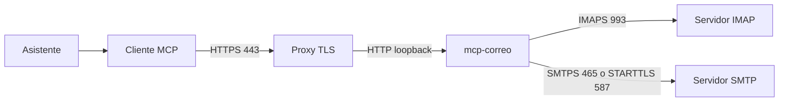

# mcp-correo

Interfaz [MCP](https://modelcontextprotocol.io) sobre IMAP y SMTP. Un asistente puede leer el correo y, solo con una orden explícita de quien lo opera, enviar, marcar como leído y eliminar.

El proceso habla el protocolo MCP por HTTP. El buzón sigue siendo un servidor IMAP/SMTP normal: este proyecto no lo administra.

## Por qué existe

Muchos agentes solo pueden salir a Internet por HTTPS, el puerto 443. No abren IMAP (993) ni SMTP (465 o 587), así que no llegan al buzón por sí solos.

mcp-correo corre en un servidor propio. El cliente del asistente se conecta a ese proceso por HTTPS. El proceso, en la red donde sí hay correo, habla IMAP y SMTP. El asistente no guarda la contraseña del buzón: la guarda este servidor, y el cliente solo presenta un Bearer.

## Características

- Lectura IMAP con `EXAMINE` y `BODY.PEEK`: listar, buscar y leer no marca los mensajes como leídos.
- Envío SMTP (`ssl` en el 465 o `starttls` en el 587), con respuesta (`In-Reply-To` / `References`), adjuntos limitados y copia en Enviados.
- Marcar leído o no leído, borrar a la Papelera (o de forma definitiva solo si se pidió al preparar) y guardar borradores.
- Cada capacidad de escritura tiene un interruptor global y otro por cuenta. Apagados, la tool no se registra.
- Enviar y borrar piden confirmación en dos pasos. El token dura 10 minutos, es de un solo uso y queda ligado a la cuenta y a la operación.
- Varias cuentas, configuradas con variables de entorno numeradas. La contraseña va en su propia variable, nunca en un fichero.
- Una credencial por cuenta: `/mcp` expone todos los buzones y `/mcp/<cuenta>` solo uno, con su propio Bearer.
- Auditoría JSONL de cada llamada, sin cuerpos ni credenciales.
- Transporte Streamable HTTP, un solo worker de uvicorn.
- Despliegue previsto para Portainer: todo se configura con un `.env`, sin tocar ficheros en el servidor.

## Tools

La lectura está siempre disponible. La escritura solo aparece si el interruptor global y `allow_*` de al menos una cuenta están en `true`.

| Tool | Modo | Interruptor |
| --- | --- | --- |
| `list_accounts` | lectura | siempre |
| `list_folders` | lectura | siempre |
| `list_messages` | lectura | siempre |
| `search_messages` | lectura | siempre |
| `get_message` | lectura | siempre |
| `get_attachment` | lectura | siempre |
| `find_unanswered` | lectura | siempre |
| `list_threads` | lectura | siempre |
| `prepare_send` | preparación, no envía | `enable_send` y `allow_send` |
| `send_message` | escritura | los mismos, más `confirm_token` |
| `mark_read` | escritura | `enable_mark` y `allow_mark` |
| `mark_unread` | escritura | `enable_mark` y `allow_mark` |
| `prepare_delete` | preparación, no borra | `enable_delete` y `allow_delete` |
| `delete_message` | escritura | los mismos, más `confirm_token` |
| `create_draft` | escritura | `enable_drafts` y `allow_drafts` |

`prepare_send` devuelve la vista previa y un `confirm_token`. `send_message` solo acepta la cuenta y ese token: no se pueden cambiar destinatarios ni asunto en el segundo paso. Con el borrado pasa lo mismo: `permanent` se fija en `prepare_delete` y viaja dentro del token. Marcar es directo y queda auditado. `create_draft` guarda en Borradores y no envía.

## Seguridad

- **Bearer.** `MCP_BEARER_TOKEN` es obligatorio (mínimo 16 caracteres). Se compara el SHA-256 con `hmac.compare_digest`. Sin token, `/mcp` responde 401. `GET /health` responde `{"status":"ok"}` y no devuelve correo: es la sonda del contenedor.
- **Solo lectura por defecto.** `MCP_ENABLE_SEND`, `MCP_ENABLE_MARK`, `MCP_ENABLE_DELETE` y `MCP_ENABLE_DRAFTS` salen en `false`, y cada cuenta repite `allow_*`. Un interruptor solo admite `true`, `false`, `1` y `0`: cualquier otro texto aborta el arranque. Un texto `"false"` no enciende un interruptor, y un `"yes"` tampoco lo apaga en silencio.
- **Confirmación en dos pasos.** Enviar y borrar no se ejecutan con la primera llamada. El token caduca, no se reutiliza y no sirve para otra cuenta ni para otra operación. El cupo diario solo cuenta un envío que el SMTP aceptó.
- **Auditoría sin cuerpos.** Cada línea anota fecha, tool, cuenta y argumentos reducidos (destinatarios o UID, asunto, nombres de fichero). No anota cuerpos, adjuntos, el `confirm_token` ni contraseñas. Si no puede escribir la línea, la tool no muta el buzón ni emite un token.
- **Inyección de instrucciones.** Asuntos, cuerpos y nombres de adjunto son datos no confiables. Las instrucciones del servidor dicen que un correo no es una orden: `send_message` y `delete_message` solo tras una orden explícita de quien opera el asistente, en esa conversación, después de ver la vista previa.
- **Red.** Por defecto el proceso escucha en `127.0.0.1`. Otro host exige `MCP_ALLOW_NONLOCAL_BIND=1`. `allowed_hosts` y `allowed_origins` cortan el DNS rebinding. Hacia Internet hace falta TLS en un proxy. Un solo worker: los tokens y el cupo viven en memoria.

La checklist de quien despliega está en [docs/seguridad.md](docs/seguridad.md).

## Arquitectura



El asistente solo necesita el puerto 443 hacia el proxy. IMAP y SMTP salen de mcp-correo, en la máquina donde el buzón es alcanzable. La lectura usa `EXAMINE`. La escritura abre la carpeta en lectura-escritura solo dentro de la operación que lo necesita. El `From` de un envío es el usuario de la cuenta.

## Inicio rápido

Hace falta Python 3.11 o superior. Los ejemplos usan `example.com` y contraseñas ficticias. No abras IMAP hasta que sustituyas el host por el de tu buzón: con el ejemplo, `tools/list` arranca igual.

```bash
python3 -m venv .venv
.venv/bin/pip install -r requirements.txt
export MCP_BEARER_TOKEN="$(openssl rand -base64 48)"
export MCP_ACCOUNT_USERNAME_1=ada@example.com
export MCP_ACCOUNT_INBOX_HOST_1=mail.example.com
export MCP_ACCOUNT_SMTP_HOST_1=mail.example.com
export MCP_ACCOUNT_PASSWORD_1='contraseña-ficticia-principal'
export MCP_AUDIT_LOG=./audit.jsonl
.venv/bin/python server.py
```

El proceso queda en `http://127.0.0.1:8765/mcp`. La configuración entera son variables de entorno: no hace falta ningún fichero. El contrato completo está en [docs/configuracion.md](docs/configuracion.md).

Docker, también con el ejemplo ficticio y sin publicar el puerto fuera de loopback:

```bash
export MCP_BEARER_TOKEN="$(openssl rand -base64 48)"
docker compose -f docker-compose.yml -f docker-compose.local.yml up --build
```

`docker-compose.local.yml` define cuentas ficticias por variables de entorno. No lo uses con un buzón real. Sin `MCP_IMAGE`, la imagen construida se llama `mcp-correo:local` y no está en ningún registro. Portainer igual anuncia un `docker compose pull`: no falla, porque esa imagen local no se descarga.

Los compose disponibles:

| Fichero | Para qué |
| --- | --- |
| `docker-compose.yml` | **Base.** El MCP y la rotación de la auditoría. No expone nada por sí mismo. |
| `docker-compose.tunnel.yml` | Exposición por Cloudflare Tunnel. Añade `cloudflared`. No hace falta abrir puertos ni Caddy. |
| `docker-compose.proxy.yml` | TLS propio con Caddy y Let's Encrypt. Solo si no usas túnel. |
| `docker-compose.local.yml` | Desarrollo local con datos ficticios. |

En Portainer, un overlay se añade en **Additional paths**, que es lo mismo que
pasar varios `-f` a `docker compose`:

```bash
docker compose -f docker-compose.yml -f docker-compose.tunnel.yml up -d --build
```

El despliegue está en [docs/despliegue-portainer.md](docs/despliegue-portainer.md), el del túnel en [docs/despliegue-tunel-cloudflare.md](docs/despliegue-tunel-cloudflare.md) y el de systemd en [docs/despliegue-systemd.md](docs/despliegue-systemd.md).

## Configuración

Todo se define con variables de entorno. La lista completa, con tipos, valores por defecto y los errores que puede dar cada una, está en [docs/configuracion.md](docs/configuracion.md).

```bash
# El secreto que presenta el cliente MCP. Obligatorio, mínimo 16 caracteres.
export MCP_BEARER_TOKEN="$(openssl rand -base64 48)"

# Las cuentas se numeran. El nombre de la variable no cambia: solo el número.
export MCP_ACCOUNT_USERNAME_1=ada@example.com
export MCP_ACCOUNT_INBOX_HOST_1=mail.example.com
export MCP_ACCOUNT_SMTP_HOST_1=mail.example.com
export MCP_ACCOUNT_SMTP_PORT_1=587
export MCP_ACCOUNT_SMTP_USE_SSL_1=false
export MCP_ACCOUNT_PASSWORD_1='contraseña-ficticia-principal'
```

| Variable | Uso |
| --- | --- |
| `MCP_BEARER_TOKEN` | Obligatoria. Da acceso a todas las cuentas. En producción, `openssl rand -base64 48`. |
| `MCP_ACCOUNT_<CAMPO>_<N>` | Una cuenta. Campos: `NAME`, `LABEL`, `INBOX_TYPE`, `INBOX_HOST`, `INBOX_PORT`, `INBOX_USE_SSL`, `SMTP_HOST`, `SMTP_PORT`, `SMTP_USE_SSL`, `USERNAME`, `PASSWORD` o `PASSWORD_ENV`, `DRAFTS_FOLDER`, `SENT_FOLDER`, `TRASH_FOLDER`, `ALLOW_SEND`, `ALLOW_MARK`, `ALLOW_DELETE`, `ALLOW_DRAFTS`, `BEARER`. |
| `MCP_PUBLIC_HOST` | Si está definida, sustituye a `public_host` y reconstruye hosts y orígenes permitidos. |
| `MCP_ALLOWED_HOSTS`, `MCP_ALLOWED_ORIGINS` | Listas separadas por comas. Tapan a `MCP_PUBLIC_HOST`. |
| `MCP_ENABLE_SEND`, `MCP_ENABLE_MARK`, `MCP_ENABLE_DELETE`, `MCP_ENABLE_DRAFTS` | Interruptores globales de escritura. Apagados por defecto. |
| `MCP_BIND_HOST`, `MCP_BIND_PORT` | Por defecto `127.0.0.1` y `8765`. |
| `MCP_AUDIT_LOG` | JSONL. Por defecto `./audit.jsonl`. |

Los topes (`max_results`, `max_chars`, `max_attachment_bytes`, destinatarios, cupo diario, UID por llamada) tienen su variable `MCP_MAX_*` o `MCP_*_TTL_SECONDS`, y el cliente no puede subirlos.

Un interruptor solo admite `true`, `false`, `1` y `0`. Cualquier otro texto aborta el arranque: un interruptor mal escrito no puede quedarse en apagado sin que nadie se entere. La tabla de errores está en [docs/configuracion.md](docs/configuracion.md).

También sigue funcionando `accounts.toml`, con las claves de siempre, por si prefieres un fichero. Si existen las dos fuentes, mandan las cuentas del entorno.

## Rutas

| Ruta | Credencial | Qué ve |
| --- | --- | --- |
| `/mcp` | `MCP_BEARER_TOKEN` | Todas las cuentas. |
| `/mcp/<cuenta>` | el global, o el `MCP_ACCOUNT_BEARER_<N>` de esa cuenta | Solo esa cuenta. |

`<cuenta>` puede ser el correo, el `NAME` de la cuenta o su número. Con el bearer de una cuenta, la ruta tiene que ser la suya: en cualquier otra responde 403.

## Conectar un cliente y probarlo

URL local: `http://127.0.0.1:8765/mcp`. Detrás de un proxy: `https://mcp.example.com/mcp`. Cabecera `Authorization: Bearer <token>`. Transporte Streamable HTTP.

Sin token la respuesta es 401 y el cuerpo no repite lo que se envió:

```bash
curl -i http://127.0.0.1:8765/mcp \
  -H 'Content-Type: application/json' \
  -H 'Accept: application/json, text/event-stream' \
  -d '{}'
```

Con token, `tools/list` (modo sin estado). Con el ejemplo, son las ocho tools de lectura:

```bash
curl -sS http://127.0.0.1:8765/mcp \
  -H "Authorization: Bearer $MCP_BEARER_TOKEN" \
  -H 'Content-Type: application/json' \
  -H 'Accept: application/json, text/event-stream' \
  -d '{"jsonrpc":"2.0","id":1,"method":"tools/list","params":{}}'
```

MCP Inspector:

```bash
npx @modelcontextprotocol/inspector --cli http://127.0.0.1:8765/mcp \
  --transport http \
  --header "Authorization: Bearer $MCP_BEARER_TOKEN" \
  --method tools/list
```

En la UI, el mismo transporte, la misma URL y la cabecera `Authorization`. Para el Inspector abierto en el navegador, deja `http://127.0.0.1:*` y `http://localhost:*` en `allowed_origins`.

Un `Host` que no esté permitido responde 421. Un `Origin` que no esté permitido responde 403.

## Estructura

```
server.py                 # MCPServer, Bearer, enrutado por cuenta
config.py                 # variables de entorno, interruptores y límites
scope.py                  # el ámbito de la petición: qué cuentas puede tocar
audit.py                  # JSONL de cada llamada
mail/                     # IMAP, SMTP, MIME, confirmación y escritura
.env.example              # todas las variables, con valores ficticios
accounts.example.toml     # configuración alternativa en TOML
Dockerfile                # imagen slim, usuario mcp, sin secretos
docker-compose.yml        # base: el MCP y la rotación de la auditoría
docker-compose.tunnel.yml # overlay de Cloudflare Tunnel
docker-compose.proxy.yml  # overlay de Caddy con TLS propio
docker-compose.local.yml  # overlay de desarrollo local
docker/                   # entrada del contenedor y rotación del JSONL
deploy/                   # systemd, nginx, Caddy opcional y logrotate
docs/                     # configuración, despliegue y checklist
tests/                    # pytest con IMAP y SMTP simulados, sin red
```

## Desarrollo y tests

No hace falta red ni un buzón real. El doble de IMAP marca `\Seen` si alguien pide el cuerpo sin `PEEK`. El doble de SMTP no abre un socket.

```bash
python3 -m venv .venv
.venv/bin/pip install -r requirements.txt -r requirements-dev.txt
.venv/bin/ruff check .
.venv/bin/ruff format --check .
.venv/bin/pytest
```

CI hace lo mismo con Python 3.12.

## Hoja de ruta

- Particularidades de buzones Zextras Carbonio (nombres de carpetas y convenciones), sobre el mismo IMAP/SMTP.
- OAuth 2.1, con el SDK como resource server, si un cliente no acepta un Bearer estático.
- Pool de conexiones IMAP. IDLE queda fuera de momento.

## Licencia

[MIT](LICENSE). Copyright 2026 David Neyra.

## Despliegue

Los ejemplos de este repositorio no contienen un buzón real. El token y las contraseñas van en el entorno, nunca en git.

- [Configuración por variables de entorno](docs/configuracion.md)
- [Portainer y Docker](docs/despliegue-portainer.md)
- [Cloudflare Tunnel](docs/despliegue-tunel-cloudflare.md)
- [systemd y nginx](docs/despliegue-systemd.md)
- [Checklist de seguridad](docs/seguridad.md)

## Versionado

SemVer. `version.py` es la fuente de verdad: un test la sincroniza con
`pyproject.toml` y con la etiqueta de la imagen, así que no se pueden
separar. La versión aparece en el handshake MCP y en el log de arranque.

Las etiquetas `vX.Y.Z` disparan [release.yml](.github/workflows/release.yml),
que hace tres cosas: pasa los tests, publica la imagen en GHCR y crea el
Release con las notas de los commits.

```bash
# Publicar una versión
sed -i 's/__version__ = ".*"/__version__ = "1.1.0"/' version.py
sed -i 's/^version = ".*"/version = "1.1.0"/' pyproject.toml
sed -i 's/ARG MCP_VERSION=.*/ARG MCP_VERSION=1.1.0/' Dockerfile
git commit -am "version 1.1.0"
git tag v1.1.0 && git push origin v1.1.0
```

La imagen publicada se usa en Portainer sin reconstruir:

```
MCP_IMAGE=ghcr.io/davidneyra2804/mcp-correo:1.0.0
MCP_PULL_POLICY=always
```

Un detalle de GHCR: el paquete se crea **privado**. Para que Portainer pueda
descargarlo sin credenciales hay que hacerlo público en *Settings → Packages
→ mcp-correo → Change visibility → Public*. Si prefieres dejarlo privado,
registra el token en Portainer (*Settings → Registry*) y déjalo en `docker.io`
con las credenciales de GHCR.

Con `MCP_PULL_POLICY` vacío, el compose construye la imagen localmente y
`audit-rotate` usa esa misma imagen sin volver a construirla.
