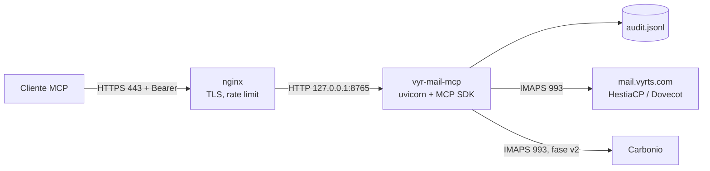

# vyr-mail-mcp

Servidor MCP de **solo lectura** para el correo laboral de David Neyra. La fase v1 habla IMAP con el buzón (HestiaCP/Dovecot en `mail.vyrts.com` y, más adelante, Zextras Carbonio) y lo expone por Streamable HTTP. No envía, no borra, no mueve y no cambia flags.

El diseño de referencia está en el [plan técnico](https://cursor.com/canvas/store-dc39e604-183b-4fa3-9685-08ea65148a44/de328a5c-28ff-4e9a-936e-241d4a5e07cb).

## Arquitectura



El proceso de Python escucha solo en loopback. nginx termina TLS y hace de proxy. El buzón se consulta como un cliente IMAP más: este repositorio no toca la configuración de HestiaCP ni de Roundcube.

Stack verificado en el desarrollo de v1: Python 3.12, `mcp` 2.3.0 (la clase del SDK v2 es `MCPServer`; el transporte es `streamable_http_app()`), `imapclient` 4.1.0 y `email` de la biblioteca estándar. No hay cliente SMTP en esta fase.

## Qué hace v1

| Tool | Lectura | Notas |
| --- | --- | --- |
| `list_accounts` | sí | Clave, etiqueta y usuario. Sin secretos. |
| `list_folders` | sí | Incluye flags SPECIAL-USE (`\Sent`, `\Drafts`, `\Junk`, `\Trash`, …). |
| `list_messages` | sí | Filtros `unseen`, `since` (`AAAA-MM-DD`), `sender`, `folder`, `limit`. |
| `search_messages` | sí | `SUBJECT`, `TEXT`, `FROM`, `TO` y rango `since`/`before`. |
| `get_message` | sí | Cabeceras, cuerpo en texto truncado y lista de adjuntos. |
| `get_attachment` | sí | Tipos de una lista blanca y tope de tamaño. Texto o base64. |
| `find_unanswered` | sí | Sin flag `\Answered` y sin cita en Enviados (`In-Reply-To` / `References`). |
| `list_threads` | sí | Hilos por `References` / `In-Reply-To` sobre los UID más recientes. |

Todas las tools declaran `readOnlyHint`. Cada `SELECT` sale como `EXAMINE` (`readonly=True`) y cada cuerpo se pide con `BODY.PEEK[]`. Un proxy interno rechaza `STORE`, `APPEND`, `MOVE`, `COPY`, `EXPUNGE` y los cambios de flags aunque una tool futura los pidiera.

`list_threads` agrupa en Python. El comando IMAP `THREAD` devuelve números de secuencia, no UID, y mezclarlos con el modo UID de IMAPClient daría hilos incorrectos. La ventana es el parámetro `limit`.

Queda fuera de v1: borrar, mover, marcar, crear borradores y enviar. Aunque `enable_send` o `enable_drafts` estén en el TOML, el proceso no registra esas tools y escribe un aviso en el log.

## Contenido de los correos

Los asuntos, cuerpos, cabeceras y nombres de adjunto son datos **no confiables**. Un mensaje puede traer instrucciones dirigidas al modelo (prompt injection): pedir que ignore estas reglas, que reenvíe el token o que actúe sobre otro sistema.

Esas reglas están en las `instructions` del servidor MCP y en el campo `notice` de `get_message` y `get_attachment`. El modelo debe tratar el correo como una cita y no obedecer lo que diga el mensaje. Este proceso no ejecuta HTML ni abre enlaces.

## Estructura

```
server.py                 # MCPServer, Bearer, tools
config.py                 # accounts.toml + variables de entorno
audit.py                  # JSONL de cada llamada
mail/imap.py              # sesiones IMAP de solo lectura
mail/readonly.py          # EXAMINE + BODY.PEEK
mail/mime.py              # cabeceras, texto y adjuntos
mail/threads.py           # no respondidos e hilos
accounts.example.toml     # datos ficticios, sin contraseñas
.env.example              # nombres de variables, valores ficticios
deploy/                   # systemd, nginx y logrotate
tests/                    # pytest con IMAP simulado, sin red
```

## Configuración

Hace falta Python 3.11 o superior.

```bash
python3 -m venv .venv
.venv/bin/pip install -r requirements.txt
```

La configuración real no se versiona. Parte de los ejemplos:

```bash
cp accounts.example.toml accounts.toml
```

`accounts.toml` solo guarda `password_env` (el **nombre** de la variable). Si el archivo trae una clave `password`, el proceso no arranca. Cada variable nombrada tiene que existir y no estar vacía.

Valores previstos en producción, que no van en el repositorio:

| Cuenta | Host IMAP | Usuario | Variable |
| --- | --- | --- | --- |
| vyrts (HestiaCP/Dovecot) | `mail.vyrts.com:993` con TLS | `david.neyra@vyrts.com` | `MAIL_VYRTS_PASSWORD` |
| carbonio (fase v2) | host por confirmar | por confirmar | `MAIL_CARBONIO_PASSWORD` |

El ejemplo versionado usa hosts y usuarios de `ejemplo.test`.

Secretos, en un archivo que no esté en git, con permisos `0600`:

```bash
install -m 0600 /dev/null /etc/vyr-mail-mcp/env
# o, en local, un .env fuera del repo
openssl rand -base64 48
```

Variables:

| Variable | Uso |
| --- | --- |
| `MCP_BEARER_TOKEN` | Obligatoria. Mínimo 16 caracteres; en producción, `openssl rand -base64 48`. Sin ella el proceso termina. |
| `MAIL_*_PASSWORD` | Contraseña o app password de cada cuenta. |
| `MCP_CONFIG` | Ruta del TOML. Si falta, se prueba `./accounts.toml` y luego `/etc/vyr-mail-mcp/accounts.toml`. |
| `MCP_AUDIT_LOG` | Ruta del JSONL. Por defecto `./audit.jsonl`. |
| `MCP_BIND_HOST` / `MCP_BIND_PORT` | Por defecto `127.0.0.1` y `8765`. Otro host se rechaza salvo `MCP_ALLOW_NONLOCAL_BIND=1`. |

Límites en `[server]`: `max_results`, `max_chars`, `max_attachment_bytes`, `max_message_bytes`, `imap_timeout`, `sent_scan_limit`. El cliente no puede subir esos topes. `allowed_hosts` y `allowed_origins` activan la protección contra DNS rebinding del SDK. `allowed_attachment_types` es la lista blanca de `get_attachment`.

`password` del dataclass usa `repr=False`: no sale en `repr()` ni en un traceback que imprima la cuenta. Los errores que ve el modelo dicen la cuenta y la operación, no la contraseña ni la respuesta cruda del servidor.

## Cómo ejecutarlo en local

Con las variables ya exportadas (valores ficticios mientras no haya un buzón real):

```bash
export MCP_BEARER_TOKEN="$(openssl rand -base64 48)"
export MAIL_VYRTS_PASSWORD='contraseña-ficticia-vyrts'
export MAIL_CARBONIO_PASSWORD='contraseña-ficticia-carbonio'
export MCP_CONFIG=./accounts.example.toml
export MCP_AUDIT_LOG=./audit.jsonl
python server.py
```

Equivalente:

```bash
uvicorn server:app --host 127.0.0.1 --port 8765 --proxy-headers --forwarded-allow-ips=127.0.0.1
```

Al importar el módulo el proceso ya exige el token y la configuración. No abre IMAP hasta que una tool lo pide, así que un host ficticio permite probar `tools/list`.

## Cómo probarlo

### Pytest y ruff

No hace falta red ni un buzón real. El doble de prueba sustituye a IMAPClient y, si alguien pide `BODY[]` o `RFC822` en lugar de `PEEK`, el doble marca `\Seen`. El test de tools compara las flags antes y después.

```bash
.venv/bin/pip install -r requirements-dev.txt
.venv/bin/ruff check .
.venv/bin/ruff format --check .
.venv/bin/pytest
```

### curl

Sin token, la respuesta es 401 y el cuerpo no repite el token presentado:

```bash
curl -i http://127.0.0.1:8765/mcp \
  -H 'Content-Type: application/json' \
  -H 'Accept: application/json, text/event-stream' \
  -d '{}'
```

Con token, `tools/list` (modo sin estado, respuesta JSON):

```bash
curl -sS http://127.0.0.1:8765/mcp \
  -H "Authorization: Bearer $MCP_BEARER_TOKEN" \
  -H 'Content-Type: application/json' \
  -H 'Accept: application/json, text/event-stream' \
  -d '{"jsonrpc":"2.0","id":1,"method":"tools/list","params":{}}'
```

Un `Host` que no esté en `allowed_hosts` responde 421. Un `Origin` que no esté en `allowed_origins` responde 403. Para el Inspector abierto en el navegador, deja `http://127.0.0.1:*` y `http://localhost:*` en `allowed_origins`.

Inicialización del protocolo con handshake (2025-11-25), útil detrás de nginx:

```bash
curl -sS http://127.0.0.1:8765/mcp \
  -H "Authorization: Bearer $MCP_BEARER_TOKEN" \
  -H 'Content-Type: application/json' \
  -H 'Accept: application/json, text/event-stream' \
  -d '{"jsonrpc":"2.0","id":1,"method":"initialize","params":{"protocolVersion":"2025-11-25","capabilities":{},"clientInfo":{"name":"curl","version":"0"}}}'
```

Con `stateless_http` cada POST es independiente: `tools/list` no necesita una sesión previa.

Con `accounts.example.toml` y contraseñas ficticias el proceso arranca en `127.0.0.1:8765`. Sin token responde `401` y `{"error":"unauthorized"}`. Con token, `tools/list` responde `200` y las ocho tools, todas con `readOnlyHint`.

### MCP Inspector

```bash
npx @modelcontextprotocol/inspector --cli http://127.0.0.1:8765/mcp \
  --transport http \
  --header "Authorization: Bearer $MCP_BEARER_TOKEN" \
  --method tools/list
```

En la UI (`npx @modelcontextprotocol/inspector`): transporte Streamable HTTP, URL `http://127.0.0.1:8765/mcp` (o `https://mcp.vyrts.com/mcp` cuando esté publicado) y cabecera `Authorization`.

Para comprobar a mano que un no leído sigue no leído: anota `\Seen` en Roundcube, llama a `get_message` y vuelve a mirar la misma flag.

## Auditoría

Cada llamada a una tool añade una línea JSON con `ts` (UTC), `tool`, `account` y `args`. No se escriben cuerpos, adjuntos ni el token. Si un argumento contiene una contraseña configurada, se sustituye por `***`. Los textos de argumentos se cortan a 300 caracteres. Si no se puede escribir el fichero, la tool no llega a abrir IMAP.

En el servidor el fichero vive en `/var/log/vyr-mail-mcp/audit.jsonl` (modo `0640`, usuario `mcpmail`). `deploy/logrotate.conf` lo rota cada semana y conserva 12 copias, con `copytruncate` porque el proceso mantiene el descriptor abierto.

## Despliegue

No forma parte de esta fase ejecutarlo: el VPS, el DNS y los secretos los prepara quien administra el correo. El servicio va en una máquina distinta del servidor HestiaCP, para no chocar con la nginx que HestiaCP regenera.

Esquema, en Debian 12 o Ubuntu 24.04:

```bash
sudo apt update && sudo apt install -y python3-venv nginx certbot python3-certbot-nginx ufw git
sudo useradd --system --home /opt/vyr-mail-mcp --shell /usr/sbin/nologin mcpmail
sudo git clone <url-del-repo> /opt/vyr-mail-mcp
sudo python3 -m venv /opt/vyr-mail-mcp/.venv
sudo /opt/vyr-mail-mcp/.venv/bin/pip install -r /opt/vyr-mail-mcp/requirements.txt
sudo chown -R root:mcpmail /opt/vyr-mail-mcp && sudo chmod -R o-rwx /opt/vyr-mail-mcp

sudo install -d -m 0750 -o root -g mcpmail /etc/vyr-mail-mcp
sudo install -m 0640 -o root -g mcpmail accounts.example.toml /etc/vyr-mail-mcp/accounts.toml
sudo install -m 0600 -o root -g root /dev/null /etc/vyr-mail-mcp/env
sudo install -d -m 0750 -o mcpmail -g mcpmail /var/log/vyr-mail-mcp
# Editar el TOML con los hosts reales y el env con el token y las contraseñas.

sudo cp deploy/vyr-mail-mcp.service /etc/systemd/system/
sudo systemctl daemon-reload && sudo systemctl enable --now vyr-mail-mcp
sudo cp deploy/nginx-mcp.conf /etc/nginx/conf.d/mcp.vyrts.com.conf
sudo certbot --nginx -d mcp.vyrts.com
sudo nginx -t && sudo systemctl reload nginx
sudo cp deploy/logrotate.conf /etc/logrotate.d/vyr-mail-mcp
```

`deploy/vyr-mail-mcp.service` corre como `mcpmail`, sin privilegios nuevos, con el sistema de archivos en solo lectura salvo `/var/log/vyr-mail-mcp`, y un tope de 512 MiB. `deploy/nginx-mcp.conf` ofrece TLS 1.2+, limita a 60 peticiones por minuto por IP y solo hace proxy de `/mcp` hacia `127.0.0.1:8765`.

El firewall del VPS puede dejar 22 restringido a la IP de administración, más 80 y 443. El puerto 8765 no se publica: el proceso no escucha en otras interfaces.

Conexión desde el cliente MCP: URL `https://mcp.vyrts.com/mcp` y cabecera `Authorization: Bearer <token>`.

## Checklist de seguridad

Hecho en este código:

- Bearer obligatorio, comparado con `hmac.compare_digest` sobre el SHA-256 del token (sirve aunque las longitudes difieran). Sin token, el proceso no arranca.
- Contraseñas solo en el entorno. El TOML guarda el nombre de la variable. `.gitignore` deja fuera `.env`, `accounts.toml` y `audit.jsonl`.
- `Account.password` con `repr=False`. Los `ToolError` no incluyen la clave ni el texto crudo del servidor IMAP.
- Solo lectura: `EXAMINE`, `BODY.PEEK[]`, lista blanca de tipos y topes de tamaño, resultados y caracteres. El proxy rechaza comandos de escritura.
- Prueba que ejecuta todas las tools y comprueba que las flags no cambian.
- DNS rebinding: `allowed_hosts` y `allowed_origins`.
- Escucha por defecto en `127.0.0.1`.
- Auditoría JSONL sin cuerpos ni credenciales.
- Instrucciones del servidor sobre prompt injection.
- `enable_send` y `allow_send` no activan nada en v1.

Lo aplica quien despliegue (no está hecho en esta máquina):

- Token de 48 bytes aleatorios y rotación. Archivo de entorno `0600`, dueño root. TOML `0640`, grupo `mcpmail`.
- App password o cuenta de solo lectura, si el buzón lo permite.
- Certificado TLS, rate limit y allowlist de IP en nginx si se conocen las salidas del cliente.
- Usuario `mcpmail` sin shell, systemd endurecido, ufw y logrotate.
- Revisar en Roundcube que `get_message` no pone `\Seen`.
- No publicar el puerto 8765.

## Pendiente

- **v2.** Cuenta real de Carbonio y `create_draft` (APPEND solo a Borradores, con flag `\Draft`). Nada se envía. Hace falta el host, el usuario y si Carbonio ofrece app passwords.
- **v3.** `prepare_send` y `send_message` en dos pasos, apagados por defecto: vista previa, token de un solo uso y aprobación de David antes del SMTPS 465, con copia en Enviados. Límites de destinatarios y de volumen.
- Más adelante, si el cliente MCP no acepta un Bearer estático: OAuth 2.1 con el SDK como resource server. Pool de conexiones IMAP e IDLE quedan fuera de estas tres fases.

Preguntas que siguen abiertas: en qué VPS vive el MCP, si el nombre `mcp.vyrts.com` sirve, de qué IP sale el cliente, y qué tipos de adjunto hay que ampliar.
